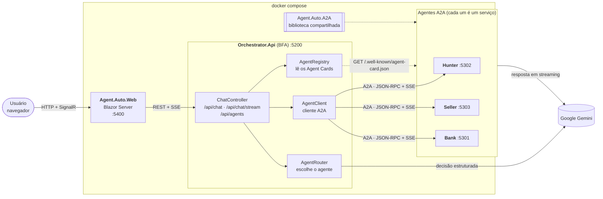
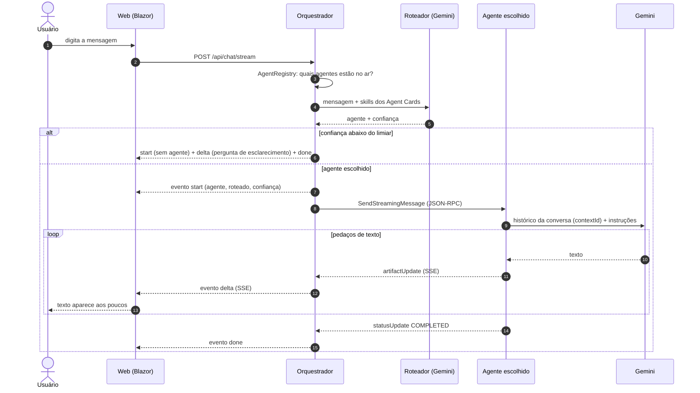

# labIA-MultiAgents

Laboratório de estudo de **orquestração de multiagentes em .NET**. Um orquestrador recebe a mensagem do usuário, escolhe qual agente deve atendê-la e devolve a resposta aos poucos (streaming). Os agentes são serviços independentes que se descrevem e conversam pelo protocolo **A2A** (Agent2Agent) e usam o **Google Gemini** como modelo.

O assunto de exemplo é o mercado de veículos, com três agentes:

| Agente | Papel |
|---|---|
| **Hunter** | Ajuda o **comprador** a encontrar o veículo que melhor se encaixa no orçamento e no uso |
| **Seller** | Ajuda o **vendedor** a vender o veículo: preço, anúncio, negociação e transferência |
| **Bank** | Esclarece o **financiamento** veicular: taxas, prazo, entrada mínima, documentos |

O projeto reimplementa em .NET (C#, `net10.0`) os conceitos vistos em cursos que usam Python, com `Microsoft.Agents.AI` e `Microsoft.Extensions.AI`.

## Desenho da solução



O **orquestrador é um BFA** (*Backend for Agents*): a interface só conhece a API dele e nunca fala direto com os agentes nem com o Gemini. O servidor Blazor chama o orquestrador, então nada do que é sensível (URLs internas, chave da API) chega ao navegador.

### Caminho de uma mensagem



Se o chamador informar o agente (`"agent": "Bank"`), o passo do roteador é pulado.

## Projetos

| Projeto | O que é |
|---|---|
| [`Agent.Auto.Web`](Agent.Auto.Web) | Interface em **Blazor Server**: seletor de agentes, chat com streaming, respostas em Markdown, tempos de resposta |
| [`src/Orchestrator.Api`](src/Orchestrator.Api) | O **BFA**: descobre os agentes, roteia, chama cada agente por A2A e repassa a resposta em SSE |
| [`Agent.Auto.A2A`](Agent.Auto.A2A) | **Biblioteca compartilhada** dos agentes: Agent Card, servidor JSON-RPC A2A (`SendMessage` e `SendStreamingMessage`), histórico por conversa, classe base do agente e cliente do Gemini |
| [`Agent.Auto.Hunter`](Agent.Auto.Hunter) · [`Seller`](Agent.Auto.Seller) · [`Bank`](Agent.Auto.Bank) | Os agentes. Cada um tem só o que é dele: nome, instruções, temperatura e o `appsettings.json` do cartão |
| [`src/Tools.Api`](src/Tools.Api) | Projeto inicial para **tools simuladas**. Ainda não faz parte da solução nem do compose |

Para criar um agente novo: referencie `Agent.Auto.A2A`, herde de `ChatMessageAgent` informando nome e instruções, e use `AddA2AAgent<T>()` e `MapA2AAgent()` no `Program.cs`. O restante (cartão, JSON-RPC, streaming, histórico) vem da biblioteca. Depois, acrescente a URL dele em `Agents:*` no orquestrador. O roteador passa a considerá-lo sozinho, a partir das skills do cartão.

## Como executar

### Pré-requisitos

- .NET SDK 10
- Docker Desktop (para subir tudo de uma vez)
- Uma chave da API do Google Gemini (Google AI Studio)

### Com Docker (recomendado)

1. Crie o arquivo `.env` na raiz a partir do exemplo e coloque sua chave:
   ```
   AI_API_KEY=sua-chave-aqui
   ```
   O `.env` está no `.gitignore`. Não o versione.
2. Suba tudo:
   ```bash
   docker compose up --build
   ```
3. Abra **http://localhost:5400**.

| Serviço | URL no host |
|---|---|
| Interface (Web) | http://localhost:5400 |
| Orquestrador | http://localhost:5200 (`/api/agents`) |
| Bank · Hunter · Seller | http://localhost:5301 · :5302 · :5303 |

### Sem Docker (`dotnet run`)

Suba cada serviço em um terminal. As portas locais já estão no `appsettings.json` do orquestrador e do Web.

```bash
export AI_API_KEY=sua-chave-aqui                      # PowerShell: $env:AI_API_KEY = "sua-chave-aqui"

dotnet run --project Agent.Auto.Bank   --urls http://localhost:5269
dotnet run --project Agent.Auto.Hunter --urls http://localhost:5087
dotnet run --project Agent.Auto.Seller --urls http://localhost:5007
dotnet run --project src/Orchestrator.Api --urls http://localhost:5200
dotnet run --project Agent.Auto.Web       --urls http://localhost:5400
```

No Visual Studio, cada projeto tem um perfil `http` com essas mesmas portas. O perfil `Container (Dockerfile)` dos agentes sobe o contêiner individual e exige o Docker Desktop ligado.

## API do orquestrador

| Método e rota | Para quê |
|---|---|
| `GET /api/agents` | Lista os agentes, se estão disponíveis e o Agent Card de cada um |
| `POST /api/chat` | Envia uma mensagem e devolve a resposta completa |
| `POST /api/chat/stream` | Igual ao anterior, mas a resposta chega por **Server-Sent Events** |

Corpo do `POST`:

```json
{ "agent": "Hunter", "message": "Quero um carro econômico até 80 mil", "conversationId": "demo-1" }
```

- `agent` é opcional. Sem ele, o roteador escolhe.
- `conversationId` é opcional. Sem ele, uma conversa nova é criada, e o id vem na resposta. Reaproveite-o nas próximas mensagens para o agente lembrar do contexto.

Eventos de `/api/chat/stream`:

| Evento | Dados |
|---|---|
| `start` | `conversationId`, `agent` (nulo se o roteador pediu esclarecimento), `routed`, `confidence` |
| `delta` | `text`: um pedaço da resposta |
| `done` | fim normal |
| `error` | `message`: falha no meio da resposta (o HTTP já era 200) |

Erros antes do início voltam como HTTP comum: **404** (agente inexistente), **503** (agente ou nenhum agente disponível), **502** (roteador ou agente falhou), **400** (mensagem vazia).

Exemplo no PowerShell:

```powershell
Invoke-RestMethod http://localhost:5200/api/agents | Select-Object key, available

$body = '{"agent":"Bank","message":"Em uma frase: o que é CET?"}'
Invoke-RestMethod http://localhost:5200/api/chat -Method Post -ContentType "application/json; charset=utf-8" `
  -Body ([Text.Encoding]::UTF8.GetBytes($body))
```

## O protocolo A2A usado

Segue a especificação A2A **1.0** (conferida na documentação oficial), no transporte **JSON-RPC**.

- **Descoberta:** cada agente publica o Agent Card em `GET /.well-known/agent-card.json`, com nome, descrição, skills e `supportedInterfaces` (endereço e transporte). O orquestrador monta o prompt do roteador a partir das skills.
- **Mensagem simples:** `POST /` com o método `SendMessage`. A resposta é uma `message`.
- **Streaming:** `POST /` com `SendStreamingMessage`, resposta `text/event-stream`. Cada evento é uma resposta JSON-RPC completa: uma `Task` em andamento, `artifactUpdate` com os pedaços de texto (`append` / `lastChunk`) e, no fim, `statusUpdate` `TASK_STATE_COMPLETED` (ou `FAILED`).
- **Conversa:** o `contextId` agrupa as mensagens. O agente guarda o histórico (últimas 10 mensagens, em memória) por `contextId`. O orquestrador só repassa o id.
- **Erros:** códigos JSON-RPC padrão (`-32700`, `-32600`, `-32601`, `-32602`, `-32603`).

Implementado só o necessário para conversar. Não há `GetTask`, `CancelTask`, notificações push, autenticação nem cartão estendido.

## Configuração

Variáveis de ambiente (no Docker, a sintaxe com `__` substitui `:` do `appsettings.json`):

| Variável | Onde | Para quê |
|---|---|---|
| `AI_API_KEY` | agentes e orquestrador | Chave do Gemini. Lida do `.env` pelo compose |
| `Gemini__ModelId` | agentes e orquestrador | Modelo do Gemini. Padrão dos **agentes**: `gemini-3.5-flash-lite`. Padrão do **roteador**: `gemini-2.5-flash` |
| `Agent__PublicUrl` | agentes | Endereço pelo qual os outros serviços alcançam o agente. É o que vai no Agent Card |
| `Agents__{Bank,Hunter,Seller}__BaseUrl` | orquestrador | Onde está cada agente |
| `Routing__MinConfidence` | orquestrador | Confiança mínima do roteador, de 0 a 1 (padrão `0.6`) |
| `Orchestrator__BaseUrl` | web | Endereço do orquestrador |
| `DOTNET_SYSTEM_NET_DISABLEIPV6` | agentes (compose) | Evita "Network is unreachable" ao chamar o Gemini de dentro do contêiner |

Os agentes sobem e servem o Agent Card **mesmo sem a chave**. Ela só é exigida na primeira pergunta ao modelo, e a falta dela aparece clara no log.

## Logs: saber quem respondeu

Cada agente registra o que recebeu e o que respondeu, com o nome do agente e o `ctx` da conversa. O orquestrador registra a decisão do roteador e cada chamada, com o **mesmo `ctx`**, o que permite casar as duas pontas:

```bash
docker compose logs -f orchestrator-api agent-auto-hunter agent-auto-seller agent-auto-bank
```

```
Roteamento: agente=Seller confiança=1.00 (limiar 0.6)
Chamando o agente Seller em http://agent-auto-seller:8080/: SendStreamingMessage ctx=f521dd…
[Agente Vendedor de Veículos] SendStreamingMessage recebido: ctx=f521dd… pergunta="Preciso vender meu carro…"
[Agente Vendedor de Veículos] SendStreamingMessage respondeu: ctx=f521dd… 2954 caracteres em 33 pedaços, primeiro em 1334 ms, total 3913 ms
Agente Seller concluiu: ctx=f521dd… 2954 caracteres em 33 pedaços, primeiro em 1402 ms, total 3978 ms
```

A pergunta aparece truncada em 80 caracteres, numa linha só.

## Decisões de projeto

- **BFA em vez de a interface falar com os agentes:** a interface ganha uma API simples e estável, e a escolha de agente, o protocolo A2A e a chave ficam atrás dela.
- **O LLM só decide, o código valida:** o roteador devolve agente e confiança como saída estruturada. Se o agente não existe, está fora do ar ou a confiança fica abaixo do limiar, o orquestrador pede esclarecimento em vez de chutar. Em perguntas de continuação, o agente que atendeu por último tem preferência.
- **Agent Card como fonte de verdade:** as skills do cartão alimentam o roteador, e o endereço de chamada vem de `supportedInterfaces`.
- **Cliente do modelo "preguiçoso":** a falta da chave não impede o serviço de subir nem o cartão de responder.
- **Uma biblioteca para o que se repete:** o código A2A dos três agentes vive em `Agent.Auto.A2A`. Cada agente ficou com cerca de 40 linhas de C#.
- **Falha no meio do stream vira evento `error`:** como o HTTP 200 já foi enviado, a falha segue pelo próprio fluxo.

## Limitações

- Histórico de conversa **em memória**: some quando o serviço reinicia.
- Sem autenticação entre os serviços nem na interface.
- A2A parcial (ver acima). O roteador usa o Gemini; um classificador dedicado (como o Jev da TypeSafe) seria mais barato e rápido, mas não foi integrado.
- Tools, banco vetorial e modelo de embeddings ainda **não existem**: estão nos planos do estudo (`src/Tools.Api` é o ponto de partida).
- As respostas dos agentes vêm do modelo e **não são aconselhamento financeiro nem preço de mercado**: os agentes são instruídos a não inventar taxas ou valores, mas isso é só um laboratório.

## Problemas conhecidos

- **Botão "Enviar" fica desabilitado e a página não reage:** o `blazor.web.js` não chegou ao navegador. O `Dockerfile` do Web não usa `--no-restore` no `publish` de propósito; com a flag, a imagem sai sem esse script. Confira se `http://localhost:5400/_framework/blazor.web.js` responde 200.
- **`Network is unreachable` ao chamar o Gemini no contêiner:** é o IPv6. O compose já define `DOTNET_SYSTEM_NET_DISABLEIPV6=1` para os agentes.
- **`error during connect ... dockerDesktopLinuxEngine`:** o Docker Desktop não está ligado.
- **Agente aparece como `indisponível`:** confira o log do contêiner dele e se `Agents__*__BaseUrl` aponta para o endereço certo. O orquestrador guarda o resultado por 30 segundos; use "Atualizar" na tela.
- **Erro `-32603 Internal error` ao conversar:** quase sempre é a chave ausente ou inválida. O motivo está no log do agente.

## Estrutura

```
labIA-MultiAgents/
├── LabIAMultiAgents.slnx
├── docker-compose.yml
├── .env.example                    # modelo do .env (o .env real não é versionado)
├── Agent.Auto.A2A/                 # biblioteca compartilhada dos agentes
│   ├── A2AAgentExtensions.cs       # AddA2AAgent<T>() e MapA2AAgent()
│   ├── Agents/                     # IMessageAgent e ChatMessageAgent (classe base)
│   ├── Configs/                    # opções do Agent Card
│   ├── Models/                     # AgentCard e tipos do A2A / JSON-RPC
│   └── Services/                   # A2AService (+ streaming), AgentCardService, ConversationStore
├── Agent.Auto.Bank/                # agente de financiamento
├── Agent.Auto.Hunter/              # agente do comprador
├── Agent.Auto.Seller/              # agente do vendedor
├── Agent.Auto.Web/                 # interface Blazor
└── src/
    ├── Orchestrator.Api/           # BFA: registro, roteador, cliente A2A, chat
    └── Tools.Api/                  # reservado para tools simuladas
```
